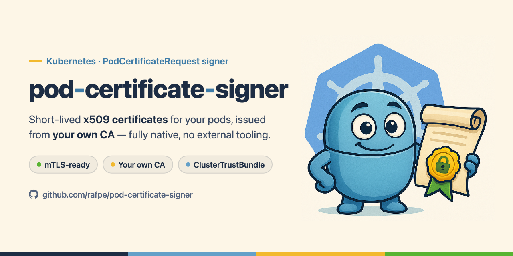

<p align="center">
  
</p>

[](https://github.com/RafPe/pod-certificate-signer/actions/workflows/test.yml)
[](https://github.com/RafPe/pod-certificate-signer/actions/workflows/lint.yml)
[](./LICENSE)
[](https://github.com/rafpe/pod-certificate-signer/releases)
[](./go.mod)
[](https://artifacthub.io/packages/search?repo=pod-certificate-signer)
[](https://scorecard.dev/viewer/?uri=github.com/RafPe/pod-certificate-signer)

# pod-certificate-signer

A Kubernetes controller that signs requests of the native `PodCertificateRequest` API.
It issues short-lived x509 certificates to your pods from your own CA.
It also publishes that CA as a `ClusterTrustBundle`.

## Why

- **The problem:** to give each pod its own short-lived x509 identity, you needed a sidecar mesh or a custom CSR pipeline.
  Each of these adds components that you must operate and secure.
- **The solution:** Kubernetes has a built-in [`PodCertificateRequest`](https://kubernetes.io/docs/reference/access-authn-authz/certificate-signing-requests/#pod-certificate-requests) API.
  It is GA in `certificates.k8s.io/v1` since Kubernetes 1.37.
  A pod asks for a certificate through a projected volume.
  The kubelet creates a `PodCertificateRequest`, and the kube-apiserver verifies its identity fields.
  This controller issues or denies the request from your CA, without sidecars or external tools.
- **The difference:** the controller also publishes its current and previous CAs as a [`ClusterTrustBundle`](https://kubernetes.io/docs/reference/access-authn-authz/certificate-signing-requests/#cluster-trust-bundles).
  Workloads mount these trust anchors next to their certificate.
  Together with a `ValidatingAdmissionPolicy`, this gives workload identity and mTLS with Kubernetes APIs only.

> [!NOTE]
> This controller signs the upstream `PodCertificateRequest` API. It is **not** a
> `CertificateSigningRequest` (CSR) signer and **not** an authentication proxy.
> It acts only on requests whose identity fields the kube-apiserver verified.

## Quickstart

Prerequisites: Kubernetes 1.37+, Helm 3+, and a signing CA (see [prerequisites](./docs/getting-started.md#prerequisites)).

The chart requires `signer.name` and a CA source.
Create a Secret from your CA, then install the published OCI chart:

```sh
kubectl create namespace pcs-system
kubectl create secret tls podcertificate-signer-ca \
  --namespace pcs-system --cert=ca.pem --key=ca-key.pem

helm install pod-certificate-signer oci://ghcr.io/rafpe/charts/pod-certificate-signer \
  --namespace pcs-system \
  --set signer.name=example.org/signer \
  --set signer.ca.secretRef.name=podcertificate-signer-ca
```

Make sure that the controller runs and published its `ClusterTrustBundle`:

```sh
kubectl -n pcs-system rollout status deploy/pod-certificate-signer
kubectl get clustertrustbundle
```

To pin a specific [release](https://github.com/rafpe/pod-certificate-signer/releases), add `--version <x.y.z>`.
Without `--version`, Helm installs the latest release.
For CA options, a workload that requests a certificate, and the verification steps, see [docs/getting-started.md](./docs/getting-started.md).

## How it works

1. A pod declares a `podCertificate` projected volume with the signer name of this controller.
2. The kubelet generates the key pair and a CSR, and creates a `PodCertificateRequest`.
3. The kube-apiserver verifies the identity fields of the request (pod, namespace, service account).
4. The controller validates the request and its annotation configuration.
5. The controller signs a short-lived certificate from your CA, or denies the request.

At the same time, the controller keeps the `ClusterTrustBundle` of the signer up to date.
Workloads use this bundle to verify their peers.

See [docs/architecture.md](./docs/architecture.md) for the full C4 model (system context, containers, components) and the request-flow sequence.

## Features

- **Native API, no sidecars:** the controller signs the built-in `PodCertificateRequest`. You do not inject anything into workloads.
- **Per-workload certificates:** set CN, SANs, IP SANs, URIs, EKU, duration and refresh with `userAnnotations` on the projected volume. The kubelet copies them into `spec.unverifiedUserAnnotations` of the `PodCertificateRequest`.
- **Secure identity by default:** a pod can get a certificate only for its own verified identity. `${...}` interpolation inserts per-pod values.
- **Preventive admission checks:** the chart can install optional `ValidatingAdmissionPolicy` resources. You enable each one separately. They can reject malformed explicit DNS SANs before the kube-apiserver stores the pod.
- **CA hot-reload:** the controller reloads the CA certificate and key from disk when they change. You can rotate the CA without a restart.
- **Trust distribution:** the controller publishes the current and previous CAs as a `ClusterTrustBundle` that workloads mount.
- **Hardened by default:** distroless non-root image, static binary built without CGO, restricted Pod Security Standard, least-privilege RBAC.

### DNS SAN validation behavior

The signer always validates the final DNS SAN list. It does this after it selects
the annotation, CSR or default value and after interpolation. The optional
admission policy gives earlier feedback for explicit
`podCertificate.userAnnotations`. The signer stays the authoritative boundary.

| Request case | Preventive admission policy | Authoritative signer |
| --- | --- | --- |
| Valid explicit or interpolated DNS SAN | Admits | Issues if identity authorization also succeeds |
| DNS label longer than 63 characters, name longer than 253 characters, or malformed DNS syntax | Denies the Pod when enabled with `Deny` | Denies the certificate request in every mode |
| Unsupported or unterminated `${...}` in an explicit SAN | Denies the Pod | Denies the certificate request |
| CSR-provided DNS SAN (with `--honor-csr-sans`) | Out of scope | Validates before identity authorization |
| Generated default for a pod name longer than 63 characters | Out of scope | Omits the default SANs. If no annotation or CSR SAN replaces them, it emits a `DefaultSANSkipped` Warning event |

Enable the DNS SAN policy on its own. Start it with `Warn` or `Audit`, then change
it to `Deny`:

```yaml
admissionPolicies:
  dnsSANValidation:
    enabled: true
    validationActions:
      - Deny
    namespaceSelector: {}
    objectSelector: {}
```

For rollout and scope details, see [configuration](./docs/configuration.md#preventive-dns-san-admission-policy).

## Documentation

| Topic | Where |
| --- | --- |
| Install, prerequisites, a working example | [docs/getting-started.md](./docs/getting-started.md) |
| Annotation contract, CLI flags, Helm values, identity model, production posture | [docs/configuration.md](./docs/configuration.md) |
| CA rotation, leader election, readiness, upgrades, troubleshooting | [docs/operations.md](./docs/operations.md) |
| C4 diagrams, component overview, security posture | [docs/architecture.md](./docs/architecture.md) |
| Writing tests that depend on time | [docs/testing/deterministic-time.md](./docs/testing/deterministic-time.md) |
| Threat model, reporting policy, supported versions | [SECURITY.md](./SECURITY.md) |
| All chart values | [charts/pod-certificate-signer/README.md](./charts/pod-certificate-signer/README.md) |
| Publishing the chart on Artifact Hub | [docs/artifact-hub.md](./docs/artifact-hub.md) |
| Cutting a release, backfilling artifacts (maintainers) | [docs/releasing.md](./docs/releasing.md) |

## Release process

Releases need a review and use labels. Each ordinary PR has exactly one
`release/*` label. Each non-skip PR adds a changelog fragment. Ordinary merges
never publish a release. To release, a maintainer runs **Prepare Release** and
reviews the `release/next` PR that the automation owns. The maintainer merges
that PR with the `main` ruleset bypass. The merge starts these steps:

- full verification and E2E tests
- an immutable `vX.Y.Z` tag
- the signed multi-arch image
- the matching OCI Helm chart

Maintainers: [docs/releasing.md](./docs/releasing.md) gives the release procedure,
the recovery rules, the artifact verification and the one-time GHCR and Artifact
Hub steps.

## Contributing

You can contribute issues and pull requests. To build the project, you need Go
1.27 or later. [CONTRIBUTING.md](./CONTRIBUTING.md) gives the development workflow
and the checks to run before you open a PR. Also read
[CODE_OF_CONDUCT.md](./CODE_OF_CONDUCT.md).
