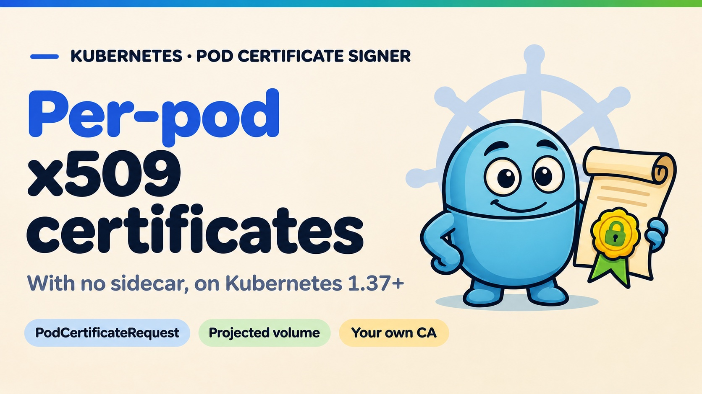

# Per-pod x509 certificates with no sidecar, on Kubernetes 1.37+



A platform team must give each pod its own short-lived x509 certificate. The certificate must name the pod, and it must come from the CA of the team. The team does not want a sidecar in each pod. It also does not want an init container that calls an external API.

Kubernetes 1.37 and later versions give most of the parts. The `PodCertificateRequest` API is GA in `certificates.k8s.io/v1` since 1.37. A pod asks for a certificate with a `podCertificate` projected volume. Kubelet creates the request, and the kube-apiserver verifies the identity fields of the request.

Each request names a signer. A signer controller watches the requests for its signer name and signs them with a CA that you supply. `pod-certificate-signer` is such a controller. It also publishes the CA as a `ClusterTrustBundle`, a cluster-scoped object that holds the trust anchors of a signer.

This article installs the signer on a Kind cluster and gets a certificate into a pod. Then it reads the request and the certificate, and explains where each value comes from. Each command ran on a Kubernetes 1.37.0 cluster, and the output is from that run.

**This article covers pod-certificate-signer 3.1.0** on Kubernetes 1.37+.

## What the signer does

A signer name is a string such as `example.org/signer`. It connects a pod to one signer. The pod writes it in the volume, and the controller starts with the same value.


The request flow has five steps when the signer issues the certificate:

1. A pod with a `podCertificate` volume starts on a node. Kubelet generates the key pair and a PKCS#10 certificate request. Kubelet then creates a `PodCertificateRequest`.
2. The kube-apiserver verifies the pod identity fields of the request.
3. The signer receives the request through a watch. It ignores requests for other signer names. It reads the pod with a direct `get`, not from a cache.
4. The signer resolves the certificate configuration and applies its identity constraints. These constraints permit only names that the pod can prove from the verified fields. Then the signer signs the leaf certificate with the current CA. It writes the chain to the request status with the condition `Issued`.
5. Kubelet reads the status and writes the private key and the certificate chain into the pod volume.

The request carries the public key in a stub PKCS#10 request. The private key never goes into the request or its status.

## Create the CA Secret

The chart ships no CA. You supply the CA certificate and key. For a test, a self-signed CA is sufficient. The CA must have `CA:TRUE` and the `Certificate Sign` key usage. The test cluster for this article used a CA with a 30-day lifetime.

Put the CA into a `kubernetes.io/tls` Secret in the namespace of the controller:


```sh
kubectl create namespace pcs-system
kubectl create secret tls podcertificate-signer-ca \
  --namespace pcs-system \
  --cert=ca.pem \
  --key=ca-key.pem
kubectl -n pcs-system get secret podcertificate-signer-ca
```

The last command shows the Secret with the type `kubernetes.io/tls` and 2 data keys, `tls.crt` and `tls.key`. Keep the CA key out of git. The chart mounts the Secret into the controller as a read-only volume.

## Install the chart

The chart is an OCI artifact on GHCR. It requires two values: the signer name and the name of the CA Secret.


```sh
helm install pod-certificate-signer \
  oci://ghcr.io/rafpe/charts/pod-certificate-signer \
  --version 3.1.0 \
  --namespace pcs-system \
  --set signer.name=example.org/signer \
  --set signer.ca.secretRef.name=podcertificate-signer-ca
kubectl -n pcs-system rollout status deploy/pod-certificate-signer --timeout=180s
```

The chart runs two replicas. On the test cluster, the rollout finished in about 10 seconds. Then the trust bundle of the signer was present. The block below is an excerpt: `...` replaces the hash in the name of the second bundle.


```text
$ kubectl get clustertrustbundle
NAME                                                            SIGNERNAME
example.org:signer:bundle                                       example.org/signer
kubernetes.io:kube-apiserver-serving:...   kubernetes.io/kube-apiserver-serving
```

The bundle name is the signer name with `/` changed to `:`, plus `:bundle`. The second bundle has a `kubernetes.io/` signer name. It is not from this project. Only the leader replica publishes the bundle and signs requests.

## Request a certificate from the pod

The pod declares one projected volume with two sources. The first source asks for the certificate. The second source mounts the CA bundle that the signer published. This is the volume from `examples/workload-pod.yaml`, without its `userAnnotations`:


```yaml
spec:
  volumes:
  - name: x509
    projected:
      sources:
      - podCertificate:
          keyType: ED25519
          signerName: example.org/signer
          credentialBundlePath: credentialbundle.pem
      - clusterTrustBundle:
          signerName: example.org/signer
          labelSelector: {}
          path: ca.crt
```

Each field has one job:

- `keyType` sets the key algorithm that kubelet generates.
- `signerName` selects the signer. It must match `signer.name` of the chart exactly.
- `credentialBundlePath` names the file for the private key and the certificate chain. The credential bundle is this file.
- `clusterTrustBundle.signerName` selects the bundles of the same signer.
- `labelSelector: {}` selects all bundles of that signer. The API requires it together with `signerName`.
- `path` names the file for the CA bundle.

The `podCertificate` source in the example also has `userAnnotations`. They give the signer the certificate configuration. Kubelet copies them without change into the request. The example sets three of them:

- `example.org/signer-cn: "${pod.name}.${pod.namespace}.svc.${cluster.fqdn}"`
- `example.org/signer-san: "${pod.name}.${pod.namespace}.svc,${pod.serviceAccountName}.${pod.namespace}"`
- `example.org/signer-uris: "spiffe://${cluster.fqdn}/ns/${pod.namespace}/sa/${pod.serviceAccountName}"`

Apply the example and read the request. The field managers show which component wrote each part of the request:


```text
$ kubectl apply -f examples/workload-pod.yaml
pod/pcs-example-workload created
$ kubectl wait --for=condition=Ready pod/pcs-example-workload --timeout=120s
pod/pcs-example-workload condition met
$ kubectl get podcertificaterequests -n default \
    -o jsonpath='{range .items[*].status.conditions[*]}{.type} {.reason}{"\n"}{end}'
Issued CertificateIssued
$ kubectl get podcertificaterequests -n default \
    -o jsonpath=\
'{range .items[*].metadata.managedFields[*]}{.manager} {.subresource}{"\n"}{end}'
kubelet 
manager status
$ kubectl exec pcs-example-workload -- ls /var/run/x509
ca.crt
credentialbundle.pem
```

In this run, the pod was `Ready` within 2 seconds after the apply. Kubelet does not start the container until it writes the credential bundle. Thus a running pod has a certificate.

The field manager `kubelet` owns the metadata and the spec. Thus kubelet created the request, not the signer. The field manager `manager` owns only the `status` subresource. `manager` is the name of the controller binary. The signer log shows `issued certificate` for the request at the same second.

## Read the certificate

`credentialbundle.pem` holds the private key, then the leaf certificate, then the CA certificate. `ca.crt` holds the trust bundle. The busybox image has no `openssl`, so read the certificate on your workstation. The `-ext` option needs OpenSSL 1.1.1 or later. The test used OpenSSL 4.1.0. The `tr` command puts each SAN on its own line.


```text
$ kubectl exec pcs-example-workload -- cat /var/run/x509/credentialbundle.pem \
    | openssl x509 -noout -subject -issuer -dates \
      -ext subjectAltName,extendedKeyUsage,keyUsage,basicConstraints \
    | tr ',' '\n'
subject=CN=pcs-example-workload.default.svc.cluster.local
issuer=CN=pcs-art-01 test CA
notBefore=Nov 16 13:13:27 2026 GMT
notAfter=Nov 17 13:13:27 2026 GMT
X509v3 Key Usage: critical
    Digital Signature
X509v3 Extended Key Usage: 
    TLS Web Server Authentication
X509v3 Basic Constraints: critical
    CA:FALSE
X509v3 Subject Alternative Name: 
    DNS:pcs-example-workload.default.svc
 DNS:default.default
 URI:spiffe://cluster.local/ns/default/sa/default
```

Each value has one source:

| Field | Value | Source |
| --- | --- | --- |
| Subject CN | `pcs-example-workload.default.svc.cluster.local` | `signer-cn` annotation |
| DNS SANs | `pcs-example-workload.default.svc`, `default.default` | `signer-san` annotation |
| URI SAN | `spiffe://cluster.local/ns/default/sa/default` | `signer-uris` annotation |
| Extended key usage | server authentication | default `eku` |
| Key usage | digital signature | key type (ED25519) |
| Basic constraints | `CA:FALSE` | set on every leaf |
| Validity | 24 hours | default `duration` |

The signer resolves `${pod.name}`, `${pod.namespace}` and `${pod.serviceAccountName}` from the verified fields of the request. `${cluster.fqdn}` comes from the chart value `signer.cluster_fqdn`, which is `cluster.local` by default. The name `default.default` is the service account `default`, then the namespace `default`.

An annotation replaces a default. Without `signer-san`, the DNS SANs are the `.pod` and `.svc` names of the pod under the cluster FQDN. Without `signer-cn`, the common name is the pod name. Each value in the example is an identity that the pod owns. Thus the default identity constraints permit the request.

The default lifetime is 24 hours. The `notBefore` is one minute before the signing time. The request status also has `beginRefreshAt: "2026-11-17T12:58:27Z"`, which is 15 minutes before `notAfter`. Kubelet uses this hint. The project docs state that kubelet refreshes the file. This article did not observe a refresh.

## When the signer name is wrong

A signer name with a different value is the most frequent problem. To see the symptom, save this pod as `wrong-signer-pod.yaml`. It asks for a certificate from `example.org/other-signer`:


```yaml
apiVersion: v1
kind: Pod
metadata:
  name: pcs-wrong-signer
  namespace: default
spec:
  restartPolicy: Never
  containers:
  - name: sleeper
    image: busybox:1.37
    command: ["sleep", "600"]
    volumeMounts:
    - name: x509
      mountPath: /var/run/x509
      readOnly: true
  volumes:
  - name: x509
    projected:
      sources:
      - podCertificate:
          keyType: ED25519
          signerName: example.org/other-signer
          credentialBundlePath: credentialbundle.pem
```

Apply the pod and wait 60 seconds. The block below is an excerpt. In the event message, `...` marks cut text. The `...` line marks more event lines that were cut:


```text
$ kubectl apply -f wrong-signer-pod.yaml
pod/pcs-wrong-signer created
$ kubectl get pod pcs-wrong-signer
NAME               READY   STATUS              RESTARTS   AGE
pcs-wrong-signer   0/1     ContainerCreating   0          60s
$ kubectl get events -n default \
    --field-selector involvedObject.name=pcs-wrong-signer,reason=FailedMount \
    -o custom-columns=REASON:.reason,MESSAGE:.message
REASON        MESSAGE
FailedMount   MountVolume.SetUp failed ... credential bundle is not issued yet
...
$ kubectl get podcertificaterequests -A \
    -o custom-columns=POD:.spec.podName,SIGNER:.spec.signerName,\
STATE:.status.conditions[*].type
POD                    SIGNER                     STATE
pcs-example-workload   example.org/signer         Issued
pcs-wrong-signer       example.org/other-signer   <none>
$ kubectl -n pcs-system logs -l app.kubernetes.io/name=pod-certificate-signer --tail=-1 \
    | grep 'another signer' | tail -1 | grep -o '"signerName.*'
"signerName": "example.org/other-signer", "controllerSignerName": "example.org/signer"}
```

The pod stays in `ContainerCreating`. The event shows the mount failure, but not the cause. The signer ignores requests for other signer names. It writes no condition and no event on them. The request list shows the cause: the request has no condition and a signer name that no controller serves. The signer log line `request is addressed to another signer; ignoring` gives both names.

To correct the problem, change the `signerName` in the pod volume and create the pod again. A request with the condition `Denied` is a different problem. The reason `InvalidUnverifiedUserAnnotations` shows an annotation that the signer does not accept.

## Limits of this setup

This article does not prove production readiness. Read these limits before you use the setup:

- The chart ships no CA. You create the CA, protect its key and plan its lifetime. The signer does not issue a certificate that would outlive the CA.
- The test cluster had one node, a 30-day test CA and a kubectl 1.35 client. The article did not observe a refresh, because the certificate lives 24 hours.
- Kubelet replaces the files, but your process must read them again. An application that loads the certificate only at start keeps the old certificate after a refresh. Read the files again before `beginRefreshAt`, or watch them for changes.
- The article does not cover the verified-identity rules and denials, CA rotation, or metrics and alerts. Later articles in this series cover each topic.

## Verify the result

The example pod runs `sleep 600` with `restartPolicy: Never`. Thus it stops after 10 minutes. Run these commands before it stops:


```sh
kubectl get clustertrustbundle example.org:signer:bundle
kubectl get podcertificaterequests -n default
kubectl exec pcs-example-workload -- cat /var/run/x509/credentialbundle.pem \
  | openssl verify \
    -CAfile <(kubectl exec pcs-example-workload -- cat /var/run/x509/ca.crt)
kubectl delete -f examples/workload-pod.yaml
kubectl delete -f wrong-signer-pod.yaml
```

The expected results:

1. The bundle `example.org:signer:bundle` exists.
2. The request for `pcs-example-workload` has the state `Issued`.
3. `openssl verify` prints `stdin: OK`. The leaf certificate chains to the CA in `ca.crt`.
4. After the delete, the requests are gone. Kubernetes deletes each request with its pod, because the pod owns it.

If a pod stays in `ContainerCreating`, compare the signer names first. Then read the conditions of its request.

Repository: https://github.com/RafPe/pod-certificate-signer

Next: the annotation contract, the identity constraints and the Helm values are in [Configuration](https://github.com/RafPe/pod-certificate-signer/blob/main/docs/configuration.md).
