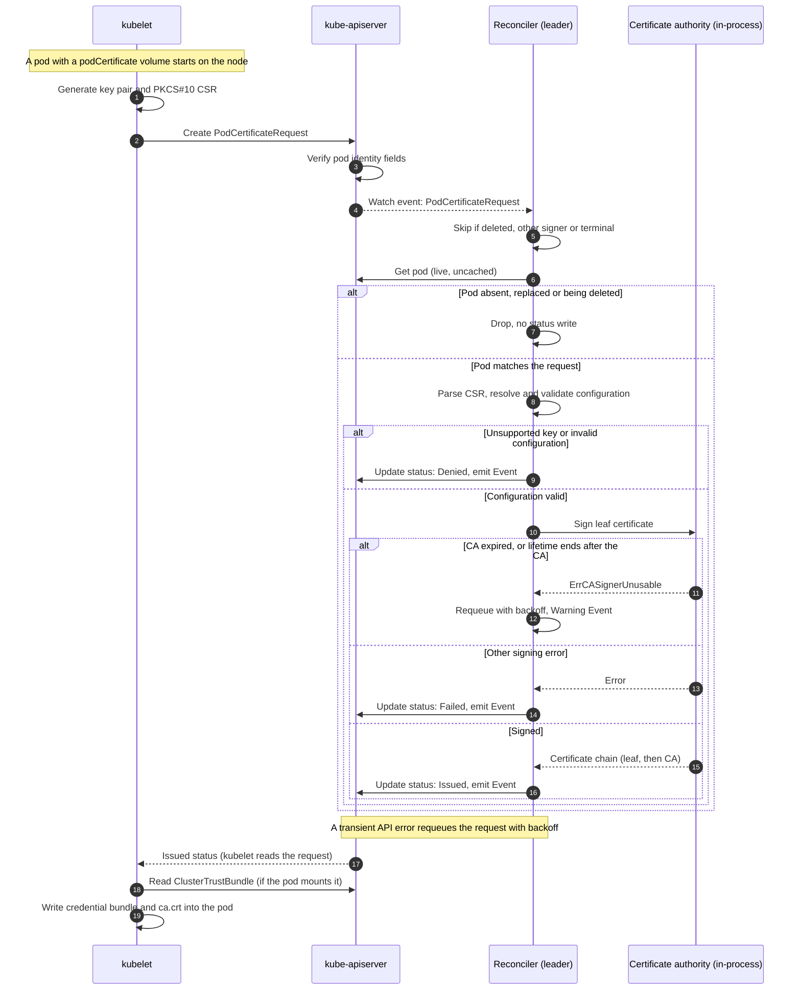
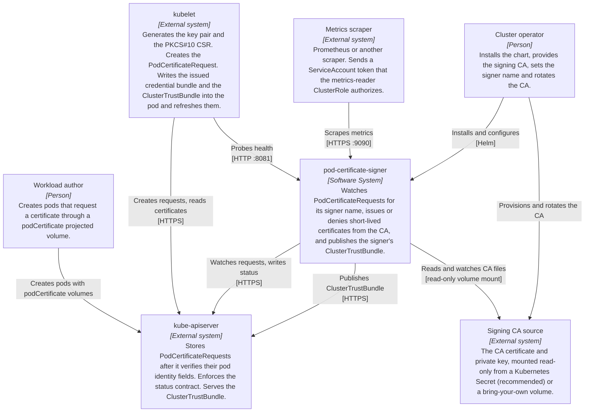
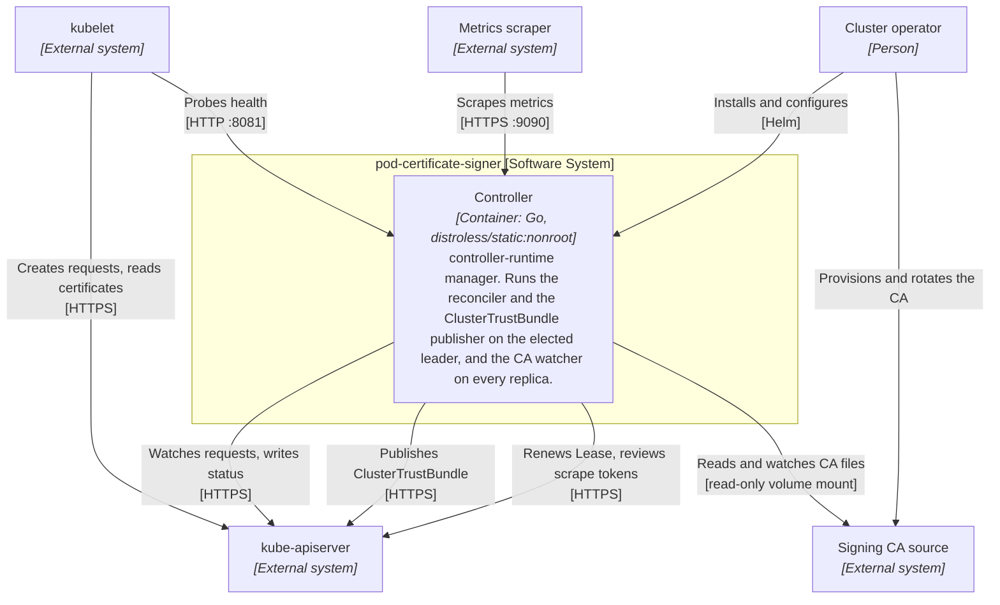
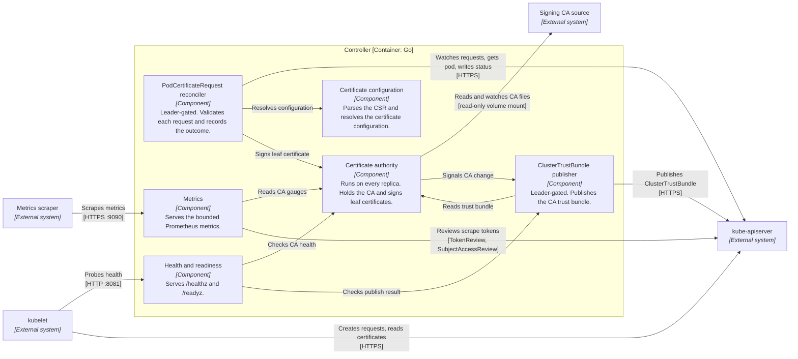

# Architecture

`pod-certificate-signer` is a Kubernetes controller for the built-in
[`PodCertificateRequest`](https://kubernetes.io/docs/reference/access-authn-authz/certificate-signing-requests/#pod-certificate-requests)
API (`certificates.k8s.io/v1`).

A pod can declare a `podCertificate` projected
volume that names this signer. Kubelet then creates a `PodCertificateRequest`.
The controller validates the request. Then it issues a short-lived X.509
certificate from your CA, or it denies the request.

The controller also
publishes the signer's CA as a
[`ClusterTrustBundle`](https://kubernetes.io/docs/reference/access-authn-authz/certificate-signing-requests/#cluster-trust-bundles).
The bundle holds the current CA and the previous CAs that it keeps across
rotations. Workloads can mount these trust anchors next to their certificates.

The controller is **not** a CSR (`CertificateSigningRequest`) signer. It is
**not** an authentication proxy. It acts only on `PodCertificateRequest`
objects. Kubelet creates these objects, and the kube-apiserver verifies their
pod identity fields before it stores them.

## Certificate issuance

## C4 model

The [C4 model](https://c4model.com/) views below zoom in from the signer in its
cluster environment to the components inside the controller. The model is in
[`c4/workspace.dsl`](./c4/workspace.dsl) (Structurizr DSL). The Mermaid
diagrams below are a manual copy of its three views. When you change the model,
change the diagrams to match. GitHub renders the Mermaid blocks natively.

### System context (C4 level 1)

This view shows who the signer serves and what it depends on. A cluster
operator provides the CA and installs the signer. Workload authors create pods
that request certificates. Kubelet creates the `PodCertificateRequest`s. The
signer watches them and publishes the `ClusterTrustBundle`.

### Containers (C4 level 2)

The signer is one deployable: a controller Deployment. The chart runs two
replicas with leader election on. The binary flag `--leader-elect` is off by
default. The controller talks to the apiserver and reads the mounted CA.

### Components (C4 level 3)

Six components run in one process inside the controller. The reconciler and
the publisher run only on the elected leader. The certificate authority, the
probes and the metrics run on every replica. The diagram shows one short action per arrow. The
[component overview](#component-overview) below gives the full detail.

## Component overview

| Component | Responsibility | Leader-gated |
| --- | --- | --- |
| **PodCertificateRequest reconciler** | Watches `PodCertificateRequest`s for the configured signer name. Reads the requesting pod with an uncached `get`. Runs the validation. Records the `Issued`, `Denied` or `Failed` outcome on the request status and emits an Event for it. Otherwise it requeues or drops the request. Writes the issuance audit record to stdout ([Auditing](./auditing.md), [ADR-0007](adr/0007-issuance-audit-record.md)). | **Yes**. controller-runtime gates controllers on leader election by default. See [ADR-0006](adr/0006-release-leader-lease-on-cancel.md). |
| **Certificate configuration** | Parses the kubelet CSR and the annotation contract. Enforces the identity constraints. Resolves `${...}` interpolation. Validates duration, refresh time and EKU against the apiserver status contract. | Not applicable. The reconciler calls this library. |
| **Certificate authority** | Holds the CA in memory. Reads the CA certificate and key from the read-only mount at startup. Reloads them on fsnotify events and every 60 seconds. Refuses a lifetime that ends after the CA expires. Signs the leaf certificate. Keeps up to `--max-previous-ca-certs` previous CAs in the trust bundle PEM. | No. Every replica keeps its CA current. |
| **ClusterTrustBundle publisher** | Names and assembles the signer's `ClusterTrustBundle` from the trust bundle of the certificate authority. Publishes it at start, on each CA change and on a 10-minute drift-repair tick. Each publish gets the bundle, then creates or patches it. Runs one publish at a time and retries with backoff. At startup, every replica reads the existing bundle to load the previous-CA history ([ADR-0004](adr/0004-bootstrapped-previous-ca-history.md)). | **Yes**, for the publish. Only the elected leader writes the shared resource. The startup read runs on every replica. |
| **Health and readiness** | Serves `/healthz` as a ping. Serves `/readyz`, which fails when the CA watcher stops, when CA reloads fail persistently, or when the last publish failed after retries. | No |
| **Metrics** | Serves the bounded `podcertificatesigner_` Prometheus surface on `/metrics`, beside the controller-runtime metrics. Reads the CA gauges from the certificate authority at scrape time. The surface counts request outcomes, requeues, drops, CA reloads and trust bundle publishes, and has CA gauges. By default, each scrape needs HTTPS, a TokenReview and a SubjectAccessReview. [ADR-0005](adr/0005-bounded-metrics-surface.md): no label carries a pod, request or certificate identity. | No |

The CA watcher runs on **every** replica. Thus a standby that becomes the
leader does not sign or publish with stale material. Signing and publishing are
leader-gated. Thus one replica at a time issues certificates and writes the
shared `ClusterTrustBundle`. [Operations](./operations.md) tells how these
components behave during CA rotation, leader changes and restarts.

## Security posture

- **Distroless, non-root image.** The controller runs on
  `gcr.io/distroless/static:nonroot` as a non-root user (UID `65532`). The
  image has no shell, no libc and no package manager. You cannot exec into a
  shell, and the image has almost no OS surface for a CVE.
- **Static, CGO-disabled binary.** The build uses `CGO_ENABLED=0` and makes a
  fully static binary. Thus the image needs no dynamic libraries, and the
  attack surface is only the Go binary.
- **Restricted pod security by default.** The chart defaults comply with the
  `restricted` Pod Security Standard: `runAsNonRoot`, `seccompProfile:
  RuntimeDefault`, `readOnlyRootFilesystem`, `allowPrivilegeEscalation: false`
  and `capabilities: drop: [ALL]`.
- **Least-privilege RBAC.** The controller reads pods with `get` only. It reads
  pods uncached and runs no cluster-wide pod informer. Its other permissions
  cover `PodCertificateRequest`s and their status, `ClusterTrustBundle`s,
  events, the signer name, and its leader-election Lease. With secure metrics
  on, it can also create TokenReviews and SubjectAccessReviews. Because `pods`
  is `get`-only, roll out the chart and the image together. See
  [Operations: upgrades](./operations.md#upgrades).
- **Default-secure identity model.** By default the signer issues certificates
  only for the apiserver-verified identity of the requesting pod. The default
  extended key usage is `serverAuth` only. See
  [Configuration: identity constraints](./configuration.md#identity-constraints).
- **CA private key handling.** The chart mounts the signing key read-only from
  a Secret. The controller holds the key in memory and reloads it on rotation
  without a restart. [SECURITY.md](../SECURITY.md) has the full threat model
  and the reporting policy.

## Next steps

- [Getting started](./getting-started.md): install the signer and issue a first
  certificate.
- [Configuration](./configuration.md): the annotation contract, the identity
  constraints, the CLI flags and the Helm values.
- [Operations](./operations.md): CA rotation, leader election, readiness,
  metrics, upgrades and troubleshooting.
- [Auditing](./auditing.md): the issuance audit record, and how to join a
  certificate serial or fingerprint to the pod that requested it.
- [Architecture decision records](./adr/README.md): the reasons behind the
  design.
