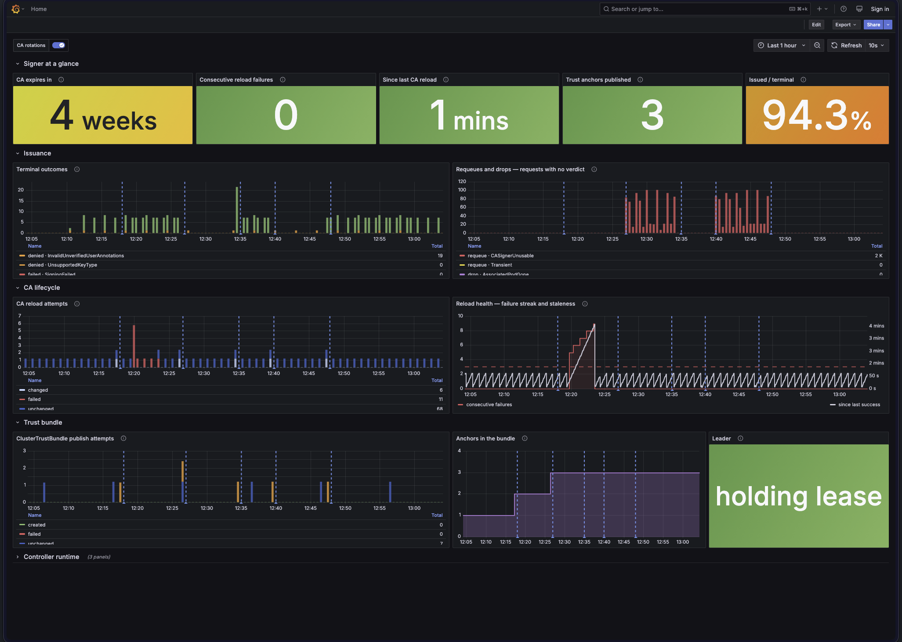

# Operations

This guide covers day-2 tasks: CA rotation, leader election, readiness,
`ClusterTrustBundle` publication, metrics, upgrades and troubleshooting. For
the component model behind these behaviors, see
[Architecture](./architecture.md).

## Rotating the signing CA

> [!CAUTION]
> **The sample CA that this repository used to ship is not a secret.**
> `examples/ca_tls_secret.yaml` contained a CA private key in plain text.
> [#37](https://github.com/rafpe/pod-certificate-signer/pull/37) removed it from
> `HEAD` and replaced it with an ephemeral CA that the install generates. But a
> deleted file stays readable in git history. Anyone can get that key and sign
> certificates that your workloads trust. If a cluster that matters ever loaded
> that CA, treat the CA as compromised. Rotate it now. Do not trust any
> certificate that it issued.

To rotate the CA, update the Secret. You do not need to restart anything:

```sh
kubectl create secret tls podcertificate-signer-ca \
  --namespace pcs-system \
  --cert=new-ca.pem \
  --key=new-ca-key.pem \
  --dry-run=client -o yaml | kubectl apply -f -
```

What happens next:

1. **The controller reloads the CA.** Every replica watches the mounted CA
   files (fsnotify) and reloads them in place. It also reloads them every 60
   seconds. New certificates get the new CA without a rollout. Kubelet updates
   a mounted Secret on its sync period and after its cache delay, so expect a
   delay. The delay can be more than 1 minute. In our test on Kubernetes
   1.37.0, the leader reloaded 29 to 62 seconds after the apply. The standby
   replica reloaded 36 to 79 seconds after the apply. Mount the Secret as a
   plain volume. Kubelet **never** updates a `subPath` mount after the pod
   starts.
2. **The old CA stays trusted.** The elected leader publishes the
   `ClusterTrustBundle` again, with the new CA first and the previous CAs after
   it. It keeps up to `--max-previous-ca-certs` (default `2`) previous CAs.
   Workloads that mount the bundle continue to verify peers that still have a
   certificate from the old CA. This order applies to the `ClusterTrustBundle`
   object. In our test, the mounted `ca.crt` files listed the CAs in a
   different order. Applications must not rely on the order of the CAs in the
   mounted file.
3. **Old certificates expire on their own.** An issued certificate stays valid
   until it expires. Its lifetime is at most the request's `duration` (default
   `24h`, capped by `maxExpirationSeconds`). Kubelet then requests a new
   certificate, which the new CA signs.

> [!IMPORTANT]
> Wait **at least one full certificate lifetime** between rotations. If you
> rotate more than `--max-previous-ca-certs` times in that window, the oldest CA
> leaves the published bundle while certificates from it are still in use.
> Those workloads then fail peer verification. To rotate faster, increase
> `--max-previous-ca-certs` first.

The retained history continues after a restart. On startup, the controller
reads the history back from the `ClusterTrustBundle` that it published. Thus
the previous CA stays trusted, even if you rotated while the controller was
stopped. If the controller cannot **read** or parse that bundle on startup, it
**fails closed**: it does not start. It does not publish an empty bundle that
removes previously trusted CAs.

The bundle is not private controller state. Thus the controller validates what
it reads back and does not accept it as is. It drops and logs these entries:

- entries that are not usable signing CAs
- expired entries
- duplicates
- entries over the `--max-previous-ca-certs` limit

The next publish repairs a bundle that someone edited by hand. The edit does
not become permanent history
([ADR-0004](./adr/0004-bootstrapped-previous-ca-history.md)).

The controller drops a previous CA from the bundle only for the reasons in the
list above. The controller applies these rules each time the CA changes. There is no separate command to remove an old
anchor.

> [!IMPORTANT]
> **Set `signer.require_ca_history: true` (the `--require-ca-history` flag)
> after the signer publishes its bundle.** The controller cannot tell a bundle
> that never existed from a bundle that someone *deleted*. By default, a
> missing bundle starts an empty history. This is correct for a first install.
> After that, it means that the retained CAs are lost at the next restart. With
> the flag on, a missing bundle stops startup. Thus you find the loss before
> the controller publishes a bundle without those CAs.

### Rotation runbook

Rotation is one `kubectl apply`, but it is not instant and it is not atomic.
The four items below decide if the rotation is quiet or if it stops a fleet.

**The delay until the new CA reaches running workloads depends on the
projection form and on the Kubernetes version.** The controller is not the
cause of the delay. It reloads and publishes within seconds after the new
Secret reaches its mount. Kubelet is the cause:

- Kubelet serves a projected `ClusterTrustBundle` from a normalization cache
  with a **hard-coded 5-minute TTL**. **No flag makes this TTL shorter.**
- Kubelet then writes the new value at the next pod sync (`--sync-frequency`,
  default 1 minute).
- Before Kubernetes 1.38, a change to a bundle with a `spec.signerName` does
  not clear the cache entries that kubelet keys by object `name`. This
  signer's bundle always has a `spec.signerName`. Thus a projection by `name`
  keeps the old anchors until the TTL expires
  ([kubernetes#141439](https://github.com/kubernetes/kubernetes/issues/141439)).
- [kubernetes#141459](https://github.com/kubernetes/kubernetes/pull/141459)
  clears these entries when the bundle changes. This change is in the tag
  `v1.38.0-beta.0`. As of 2026-11-16, Kubernetes 1.38.0 is not released. As
  of the same date, the change is not in the 1.37 branch, and no cherry-pick
  PR exists.

| Projection form | Kubernetes 1.37 | Kubernetes 1.38 and later |
| --- | --- | --- |
| `signerName` (with `labelSelector`) | Upstream measured 0 to 95 seconds. Our rotation test measured **50 to 124 seconds** after the Secret apply, and 20 to 61 seconds after the bundle update. | kubernetes#141459 changes only the entries keyed by `name`. Not measured. |
| `name` | Up to about 6 minutes: the TTL plus one pod sync. Our e2e tests measured **5m13s** and **5m26s** on two runs. Our rotation test measured **274 to 315 seconds** after the Secret apply, and 211 to 271 seconds after the bundle update. Upstream measured 290 to 374 seconds. | Kubelet clears the entry when the bundle changes. Upstream measured 0 to 95 seconds for the comparable case. Not measured. |

The upstream figures come from the description of kubernetes#141459. Upstream
measured them on kind clusters without the change. One pod mounted one bundle
three ways. The comparable case for 1.38 is a projection by `name` of a bundle
without a `spec.signerName`. The e2e figures come from the e2e suite of this
repository. It projects by `name` on a `kindest/node:v1.37.0` cluster.

The rotation test figures come from one manual test on 2026-11-16. It used
Kubernetes 1.37.0 on Kind, chart 3.1.0 and one node. One pod mounted the
bundle by `signerName` and by `name`. The test made three rotations. We
counted each time from the Secret apply. The leader reloaded and published
the bundle 29 to 62 seconds after the apply. The three rotations ran 5 to 6
minutes apart and share one kubelet cache rhythm. Thus they are not
independent samples. The ranges are not bounds.
[`examples/workload-pod.yaml`](../examples/workload-pod.yaml) and
[Getting started](./getting-started.md) project by `signerName`.

The two forms trust different sets of CAs. A projection by `name` trusts one
named `ClusterTrustBundle` object. A projection by `signerName` trusts every
bundle for that signer that the `labelSelector` selects. `labelSelector: {}`
selects all of them. Do not change the form only to get a shorter delay.

Plan the maintenance window for the delay in the table, not for the time of
the apply. On Kubernetes 1.37 with the `name` form, plan for six minutes.

**Rotate with an overlap window. Do not swap the CAs.** During the delay, some
pods have a certificate from the old CA and some from the new CA.
Verification must work in both directions. `signer.max_previous_ca_certs`
(default `2`) makes this possible. The published bundle contains the new CA
*and* its predecessors, so peers on both sides of the change stay trusted. To
rotate:

1. Apply the new CA Secret.
2. Wait until the certificates from the old CA expire.
3. Rotate again only after step 2.

> [!TIP]
> **Do not restart the workloads to get the new CA.** A restart of every pod
> replaces the wait in the table above with a restart of the fleet. The
> restarted pods also read their anchors through the same cache. The overlap
> window exists so that no pod must restart.

**Applications must read the file again.** Kubelet writes a new `ca.crt` under
a running container and sends no notification: no signal, no restart, no
event. An application that loads its trust anchors one time at startup uses
the old set until it restarts. Thus a rotation that reached every pod can
still cause a verification failure some hours later. Load the anchors again on
a timer, on a file watch, or for each connection.

> [!WARNING]
> **A stuck credential also stops the trust anchor updates.** Kubelet writes a
> projected volume in a single pass. If any source fails, kubelet does not
> write the volume. Thus, when the `podCertificate` refresh of a pod is denied
> or fails, the pod also stops getting `ca.crt` updates. The pod continues to
> run with its old anchors, and a rotation never reaches it. Do not assume
> that the anchors in a running pod are current. Alert on the condition of the
> request. Also alert on the `CASignerUnusable` warning event. The controller
> emits it while a CA cannot sign a request.

```sh
# Requests that are stuck rather than issued, across the cluster.
kubectl get events -A --field-selector reason=CASignerUnusable
```

## Leader election and replicas

The chart runs `replicaCount: 2` with `leader_election.enabled: true`. Some
work runs on every replica, and some work runs only on the leader:

- **CA watching runs on every replica.** A standby keeps its in-memory CA
  current. Thus it does not sign with old material immediately after it
  becomes the leader.
- **Signing and `ClusterTrustBundle` publication run only on the leader.**
  controller-runtime runs controllers only on the leader by default. The
  publisher requests leader election explicitly. Thus one replica at a time
  issues certificates and writes the shared resource.

When the leader stops voluntarily (for example on pod delete or a rolling
upgrade), it releases the Lease. A standby then takes over in about 1.2s
(median), not 16.3s. If the leader stops without a release (node failure,
`SIGKILL`), the standby waits for the Lease to expire (15s)
([ADR-0006](adr/0006-release-leader-lease-on-cancel.md)).

Autoscaling (`autoscaling.enabled`) gives little value for a controller with
leader election. Extra replicas are warm standbys. They do not add throughput.

## Readiness and health

The controller serves two endpoints (default port `:8081`):

- **`/healthz`**: liveness. It is a simple ping.
- **`/readyz`**: readiness. It has two checks:
  - **`certificate-authority`**: the check fails immediately when the CA
    watcher stops. It also fails when CA reloads fail persistently: **3**
    consecutive failed attempts, with the first failure at least **10
    minutes** ago. Both conditions must be true. A shorter failure keeps the
    replica ready, because the replica keeps the last good CA and signing
    continues.
  - **`clustertrustbundle`**: the check fails when the last publish failed
    after all retries. Only the leader publishes, so only the leader can fail
    this check. The next successful publish clears it.

A replica that fails readiness leaves the Service endpoints. Readiness does
not release the leader Lease.

To see the result of each check:

1. Forward the probe port of one replica:
   `kubectl -n pcs-system port-forward deploy/pod-certificate-signer 8081:8081`.
2. In a second shell, run `curl -s 'http://localhost:8081/readyz?verbose'`.
3. Check that each check shows `ok`.

## ClusterTrustBundle publication

The publisher makes the signer's `ClusterTrustBundle` match the current CA. It
publishes at these times:

- on startup, so a new leader publishes from its current in-memory CA
- on each CA reload that changes the CA
- every 10 minutes (the **drift-repair tick**), also without a reload, to repair
  a manual edit or a lost event

One goroutine runs all publishes, in order. Each publish gets up to 5 attempts,
with exponential backoff that starts at 500ms. When all attempts fail, the
publisher increments
`podcertificatesigner_clustertrustbundle_publish_attempts_total{result="failed"}`
and the leader fails readiness.

The counter counts each publish one time, with its result. Thus:

- If `{result="unchanged"}` stops increasing, the leader stopped publishing.
- If `{result="updated"}` increases on a drift-repair tick with no CA rotation,
  someone edited the bundle and the signer replaced the edit.

Examine the published bundle:

```sh
kubectl get clustertrustbundle
kubectl get clustertrustbundle <name> -o jsonpath='{.spec.trustBundle}' \
  | openssl crl2pkcs7 -nocrl -certfile /dev/stdin | openssl pkcs7 -print_certs -noout
```

## Metrics

The signer exposes nine custom metric families with the
`podcertificatesigner_` prefix. They are on the same authenticated endpoint as
the controller-runtime metrics (see
[ADR-0005](adr/0005-bounded-metrics-surface.md)). **No label contains a pod,
namespace, request or certificate identity.** Thus a 10-pod cluster and a
10,000-pod cluster have the same number of time series.

The table shows each name without the prefix. Add `podcertificatesigner_` in
queries.

| Metric | Type | Labels | What it answers |
| --- | --- | --- | --- |
| `podcertificaterequests_total` | counter | `outcome`, `reason` | Does the signer deny or fail requests? It carries the SLI. |
| `podcertificaterequest_requeues_total` | counter | `reason` | Does something retry forever? |
| `podcertificaterequest_drops_total` | counter | `reason` | Do requests live longer than their pods? |
| `ca_reload_attempts_total` | counter | `result` | Did the CA rotate, and do reloads fail? |
| `ca_reload_consecutive_failures` | gauge | — | Will this replica soon leave the Service? |
| `ca_reload_last_success_timestamp_seconds` | gauge | — | Do reloads occur at all? |
| `ca_expiration_timestamp_seconds` | gauge | — | When will the signer become unable to sign? |
| `clustertrustbundle_publish_attempts_total` | counter | `result` | Does the leader still publish? Does someone else edit the bundle? |
| `trust_bundle_certificates` | gauge | — | How many anchors does the signer publish? |

Label values:

- `outcome`: `issued`, `denied`, `failed`.
- `reason` on `podcertificaterequests_total`: `CertificateIssued`,
  `UnsupportedKeyType`, `InvalidUnverifiedUserAnnotations`, `SigningFailed`.
- `reason` on `podcertificaterequest_requeues_total`: `CASignerUnusable`,
  `Transient`.
- `reason` on `podcertificaterequest_drops_total`: `AssociatedPodGone`.
- `result` on `ca_reload_attempts_total`: `changed`, `unchanged`, `failed`.
- `result` on `clustertrustbundle_publish_attempts_total`: `unchanged`,
  `created`, `updated`, `failed`.

Operators cannot otherwise see two outages before they occur. These
expressions find them:

```promql
# The signer is about to be unable to issue a default-duration (24h)
# certificate. Past this point requests requeue and pods sit in
# ContainerCreating. The request gets no condition, only a rate-limited
# CASignerUnusable warning event.
podcertificatesigner_ca_expiration_timestamp_seconds - time() < 86400

# The reload loop has stopped. It reloads every 60s regardless of events, so
# nothing failing is not the same as everything working: a dropped watch or a
# wedged ticker produces no failures at all.
time() - podcertificatesigner_ca_reload_last_success_timestamp_seconds > 300
```

Two more expressions are useful:

- The first expression gives a warning before readiness fails. Readiness fails
  10 minutes after the first failed reload. With `for: 5m`, this alert fires
  about 3 to 5 minutes before that.
- The second expression shows that someone edited the trust anchors of the
  cluster and the signer replaced the edit.

```promql
podcertificatesigner_ca_reload_consecutive_failures >= 3   # for: 5m

increase(podcertificatesigner_clustertrustbundle_publish_attempts_total{result="updated"}[1h]) > 0
  unless
increase(podcertificatesigner_ca_reload_attempts_total{result="changed"}[1h]) > 0
```

Two facts help when you read these metrics:

- `ca_reload_attempts_total` counts *attempts*. A reload after a file event
  makes up to five attempts, and the periodic reload makes one. Thus the
  counter can increase by five when the log shows one failed reload.
- `trust_bundle_certificates` shows the in-memory bundle that the signer
  *would* publish. It does not read the `ClusterTrustBundle` object. Thus it
  does not show drift in the published bundle.

### Grafana dashboard

[`docs/dashboards/pod-certificate-signer.json`](dashboards/pod-certificate-signer.json)
is a dashboard for all of these metrics. Import it through the Grafana UI. Or
provision it from a `ConfigMap` that you mount under the `path` of a file
provider.



The capture above is from an exercise, not from an idle cluster. This view is
more useful. The dashed vertical lines are CA rotations, from
`ca_reload_attempts_total{result="changed"}`. Read across them:

- The failure streak increases to 9 and goes back to 0 when the CA is
  repaired.
- `Anchors in the bundle` goes from 1 to 2 to 3, because each rotation keeps
  its predecessor.
- The requeue burst comes from a CA with a lifetime too short for the
  requested certificate lifetime.
- Issuance never stops. A failed reload keeps the last good CA, so the signer
  continues to sign while the reload loop is broken.

Each panel reads through a `datasource` dashboard variable, not a hard-coded
datasource uid. Thus it uses your default Prometheus on import, and it shows a
picker if you have more than one. You do not need to edit anything else.

The top row gives the fast summary: CA expiry, the reload failure streak,
reload staleness, published anchors and the issuance SLI. The rows below show
issuance, CA lifecycle, trust bundle publication and a collapsed
controller-runtime row. The description of each panel tells how to read its
metric, from the metric's `Help` text.

Three series stay at zero on a healthy cluster. This is not a fault:

- **`drops_total`.** Usually a request whose pod is gone is deleted before the
  signer reconciles it. Garbage collection removes it with its pod, and
  kube-controller-manager also removes requests without a pod. The counter
  records the rare case where the signer's live pod read occurs first.
- **`denied{reason="UnsupportedKeyType"}` and `failed{reason="SigningFailed"}`.**
  kube-apiserver validates the `keyType` of a projection against a closed
  enum, and the signer supports all of its values. A failed CA reload keeps the
  last good CA, so signing does not fail because of the reload.

The signer exports all three as zero from the first scrape. They do not appear
only at the first occurrence. Thus an alert such as `rate(...) > 0` has a
series to evaluate immediately.

## Upgrades

> [!IMPORTANT]
> **Upgrade the chart and the image together.** The controller's RBAC gives
> **`get` only** on `pods`. The controller reads the pod of each request
> directly (uncached) and does not `list` or `watch` pods. An earlier binary
> used a cached pod informer (`list` and `watch`). If you upgrade the chart
> before the image, the old controller does not have the permissions it needs.
> The chart `appVersion` sets the image tag, so the two ship as a unit. A normal
> `helm upgrade` to a released chart version keeps them aligned.

## Troubleshooting

A pod that projects a `podCertificate` volume stays in `ContainerCreating`
until kubelet writes its credential bundle. Use the items below to find why
the bundle is not written.

**Signer name mismatch.** This is the most frequent problem. The controller
ignores requests for other signer names and writes no condition on them.

1. List the signer name of each request:
   `kubectl get podcertificaterequests -A -o custom-columns=NS:.metadata.namespace,NAME:.metadata.name,SIGNER:.spec.signerName`.
2. Compare each value with `--signer-name` (Helm `signer.name`). They must be
   exactly the same.
3. If a value is different, correct the `signerName` in the projected volume
   of the workload.
4. Check that the new request gets an `Issued` condition with
   `kubectl describe podcertificaterequest -n <namespace>`.

**CA failures.** A CA that is not valid fails each reload, but the signer keeps
the last good CA.

1. Search the controller logs for
   `failed to reload CA certificate; retaining the last-good CA`.
2. Examine the CA with
   `openssl x509 -in ca.pem -noout -text`.
3. Make sure that the CA has `CA:TRUE` and `Certificate Sign`.
4. Make sure that it is not expired, and that its `Not Before` is not more
   than 5 minutes in the future.
5. Make sure that the private key matches the certificate.
6. Correct the Secret.
7. Check that the log shows `CA certificate reloaded successfully` and that
   `podcertificatesigner_ca_reload_consecutive_failures` is `0`.

**CA cannot sign the request.** The request has no condition, and the
`CASignerUnusable` warning event is on it. The CA expired, or its remaining
validity is shorter than the requested certificate lifetime.

1. Find the requests:
   `kubectl get events -A --field-selector reason=CASignerUnusable`.
2. Rotate to a CA that is valid for longer than the requested lifetime (see
   [Rotating the signing CA](#rotating-the-signing-ca)).
3. Check that the requests get an `Issued` condition. The controller retries
   them without more action.

**Configuration errors.** A `Denied` condition with reason
`InvalidUnverifiedUserAnnotations` contains the exact error in its message:

```sh
kubectl describe podcertificaterequest -n <namespace>
```

1. Read the error in the condition message.
2. Correct the annotation that the message names, in the pod's
   `userAnnotations`.
3. Change one item at a time. Read the controller logs after each change.
4. Check that a new request for the pod gets an `Issued` condition. The
   denied request keeps its `Denied` condition.

### Logs

```sh
kubectl logs -n pcs-system deployment/pod-certificate-signer
```

To change the log detail, set `log.level` (`info`, `error`, `debug`, `panic`)
and `log.encoder` (`console` or `json`) in the chart values.
